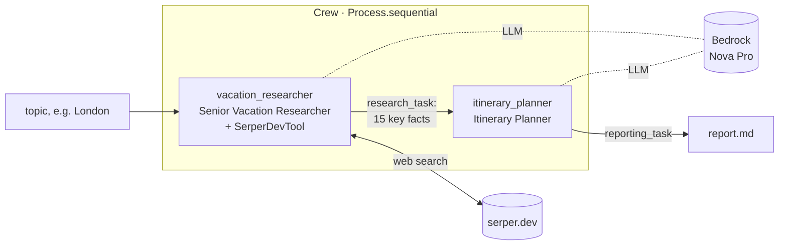

# Vacation-Planner-Crew-AI-on-AWS

A two-agent **vacation planner** built with **CrewAI** and **Amazon Bedrock (Amazon Nova
Pro)**. Give it a destination and a research agent searches the web with **Serper**, then an
itinerary agent turns the findings into a Markdown travel report: history, top tourist spots
and must-try local food.

Built while following the *Agentic AI on AWS* course (section "CrewAI: Build Vacation
Planner Agent With CrewAI").

## How it works



| CrewAI concept | In this project | Defined in |
| --- | --- | --- |
| Agents | `vacation_researcher` (with `SerperDevTool`), `itinerary_planner` | `config/agents.yaml` + `crew.py` |
| Tasks | `research_task` → 15 bullet points; `reporting_task` → full Markdown report written to `report.md` | `config/tasks.yaml` + `crew.py` |
| Process | Sequential: research first, then the report | `crew.py` |
| Crew | `VacationPlanner().crew().kickoff(inputs={"topic": ...})` | `crew.py`, `main.py` |

`{topic}` in the YAML is filled from the kickoff inputs. `main.py` uses `London`, and the
Streamlit UI uses whatever destination you type.

## Repository layout

```text
demo_app_without_Streamlit_UI_v2.0/demo_app/
  vacation_planner/          # CLI version: run with `crewai run`
  CrewAI Installation and Run Guide
demo_app_with_Streamlit_UI/
  vacation_planner/          # same crew + streamlitui.py web front end
  CrewAI Installation and Run Guide.txt
```

Both are standard `crewai create crew` projects:

```text
vacation_planner/
  .env.example               # copy to .env
  pyproject.toml / uv.lock   # dependencies (managed by uv)
  knowledge/user_preference.txt
  src/vacation_planner/
    config/agents.yaml       # roles, goals, backstories
    config/tasks.yaml        # descriptions, expected outputs
    crew.py                  # agents, tasks, crew wiring
    main.py                  # run / train / replay / test entry points
    tools/custom_tool.py     # CrewAI template, unused
  streamlitui.py             # UI version only
```

| | Without UI (v2.0) | With Streamlit UI |
| --- | --- | --- |
| Model | From `MODEL` in `.env` (CrewAI's default LLM) | Hard-coded `LLM(model="bedrock/us.amazon.nova-pro-v1:0")` on both agents |
| Extra dependency | — | `streamlit` |
| Entry point | `crewai run` | `streamlit run streamlitui.py` |

## Prerequisites

- **Python 3.11** recommended. `pyproject.toml` allows `>=3.10,<3.13`, but 3.12 had
  dependency build issues during the course.
- **uv** and the **CrewAI CLI**: `pip install uv`, `uv tool install crewai`, then
  `uv tool update-shell` once so `crewai` is on your PATH
- **AWS credentials** for an IAM user with `bedrock:InvokeModel`, configured with
  `aws configure` (or in `.env`; see below)
- **Bedrock model access** to **Amazon Nova Pro** enabled in the Bedrock console. The
  `us.` model ID is a cross-region inference profile, so enable it in the US regions it
  routes to.
- A **Serper API key** from [serper.dev](https://serper.dev) (there is a free tier)

## Setup

In the app folder you want to run (`.../vacation_planner`):

```bash
cp .env.example .env        # then fill in SERPER_API_KEY (and AWS keys if not using aws configure)
crewai install              # creates .venv and installs from uv.lock
```

`.env` settings:

| Variable | Example | Purpose |
| --- | --- | --- |
| `MODEL` | `bedrock/us.amazon.nova-pro-v1:0` | LLM for the crew (provider/model-id) |
| `AWS_REGION_NAME` | `us-west-2` | Bedrock region |
| `SERPER_API_KEY` | — | Web search for the researcher. **Must be upper case** |
| `AWS_ACCESS_KEY_ID` / `AWS_SECRET_ACCESS_KEY` | — | Optional; otherwise the default AWS credential chain is used |

## Run

**CLI** (from `demo_app_without_Streamlit_UI_v2.0/demo_app/vacation_planner`):

```bash
crewai run
```

Change the destination in `src/vacation_planner/main.py` (`'topic': 'London'`). The report
is written to `report.md` in the current folder.

**Streamlit UI** (from `demo_app_with_Streamlit_UI/vacation_planner`; it must be this
folder, because the UI imports `src.vacation_planner.crew`):

```bash
uv run streamlit run streamlitui.py
```

Type a destination or click Paris, Tokyo, Rome or Bali. The finished plan is shown on the
page and can be downloaded as Markdown.

## Customising

- **Agents and tasks:** edit `config/agents.yaml` and `config/tasks.yaml`. Keep the `{topic}`
  placeholder.
- **Model:** change `MODEL` in `.env`. In the UI version, also change the `LLM(...)` line in
  `crew.py`.
- **Hierarchical process:** `crew.py` has `process=Process.hierarchical` commented out. It
  also needs a `manager_llm`.

## Known limitations

- **`knowledge/user_preference.txt` is not used.** The crew passes no `knowledge_sources`.
  Wiring it in also needs an `embedder` setting, because CrewAI embeds knowledge with
  OpenAI by default.
- **`train` and `test` in `main.py` are CrewAI template leftovers.** They use the topic
  `"AI LLMs"`, and `test` expects an OpenAI model name.
- **`report.md` is a shared file.** Every run overwrites it, and the Streamlit UI reads it
  back from the working folder, so two runs at once would mix up their reports. It is
  gitignored as generated output.
- `tests/` is empty and `tools/custom_tool.py` is the unused CrewAI template.
